<div align="center">

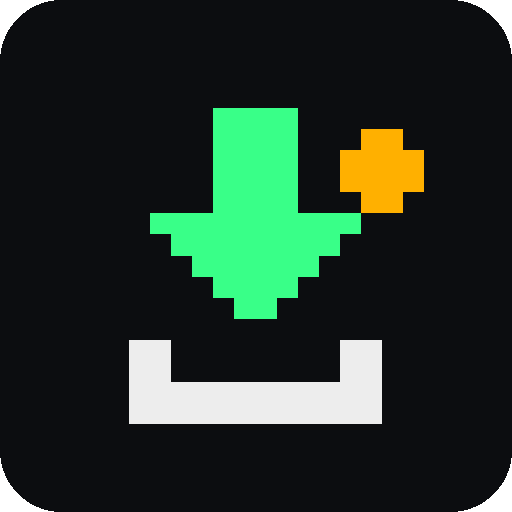

# CDM+ Downloader

**Fast multi-connection download manager for Android, with a pixel-minimalist UI.**
Browser with GRAB, YouTube / Instagram / TikTok, MEGA, torrents and a built-in ad-block VPN, all in one app.

[](https://github.com/KyotoByte/CDM-Plus-Downloader/releases/latest)
[](https://github.com/KyotoByte/CDM-Plus-Downloader/releases)
[](LICENSE)
[](#-install)
[](https://kotlinlang.org)
[](https://developer.android.com/compose)
[](https://github.com/KyotoByte/CDM-Plus-Downloader/stargazers)

<br>

<a href="https://github.com/KyotoByte/CDM-Plus-Downloader/releases/latest">
  
</a>

<sub>Free · open source · no ads · no account · no tracking</sub>

</div>

---

## 📥 Which APK?

Open the [latest release](https://github.com/KyotoByte/CDM-Plus-Downloader/releases/latest) and pick **one** file:

| APK | Pick it if… |
|---|---|
| `CDM-Plus-Downloader-v1.0-arm64-v8a.apk` | ✅ **Most phones.** Any 64-bit phone from the last ~6 years. Smallest download. |
| `CDM-Plus-Downloader-v1.0-armeabi-v7a.apk` | 📱 Old 32-bit ARM phones |
| `CDM-Plus-Downloader-v1.0-x86_64.apk` | 💻 Emulators, Chromebooks, x86_64 tablets |
| `CDM-Plus-Downloader-v1.0-x86.apk` | 💻 Old 32-bit x86 emulators/devices (no torrent support) |
| `CDM-Plus-Downloader-v1.0-universal.apk` | 🤷 **Not sure?** Works on every device (bigger file, all CPU types inside) |
| `CDM-Plus-Downloader-v1.0-debug.apk` | 🧪 Testing / bug reports. Separate app ("CDM+ Debug") that installs **beside** the normal one |

> [!TIP]
> Don't know your phone's CPU? Take **arm64-v8a**. If it says "app not installed", take **universal**.

## 📸 Screenshots

<div align="center">

<table>
  <tr>
    <td align="center">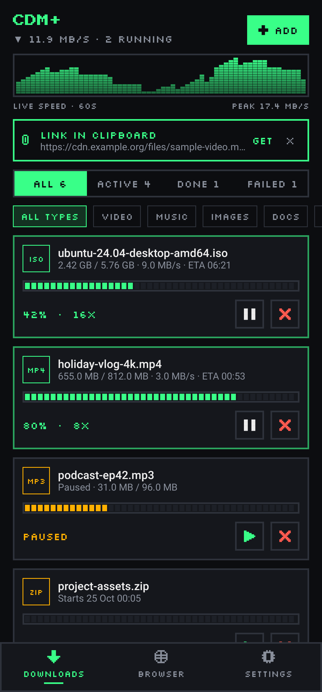<br><sub><b>Downloads</b></sub></td>
    <td align="center">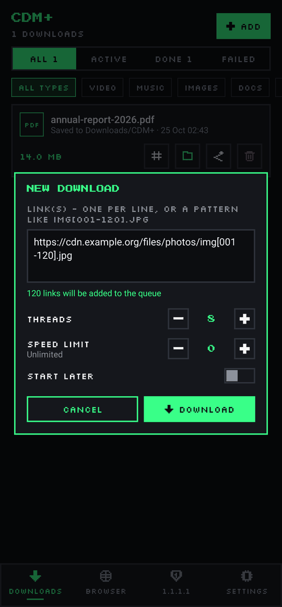<br><sub><b>Add download</b></sub></td>
    <td align="center">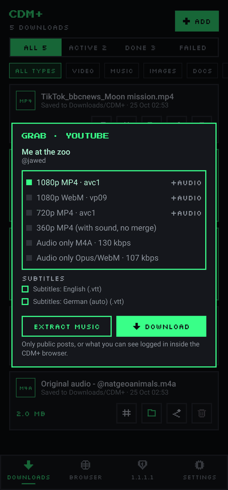<br><sub><b>GRAB · YouTube</b></sub></td>
    <td align="center">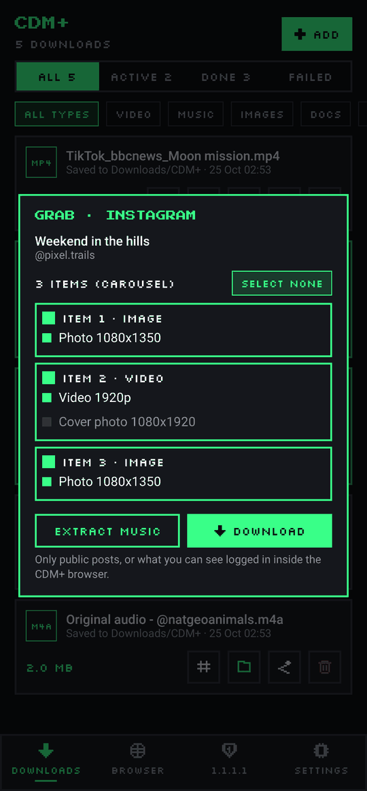<br><sub><b>GRAB · Instagram</b></sub></td>
  </tr>
  <tr>
    <td align="center">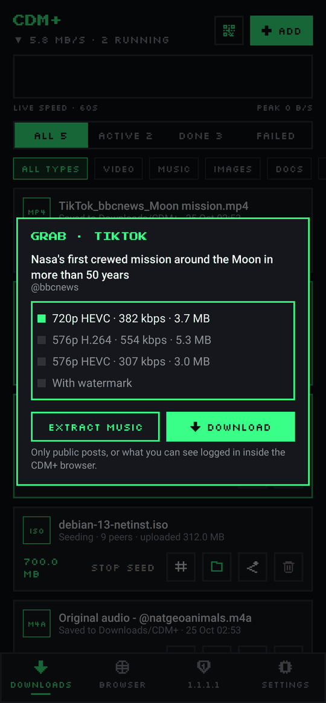<br><sub><b>GRAB · TikTok</b></sub></td>
    <td align="center">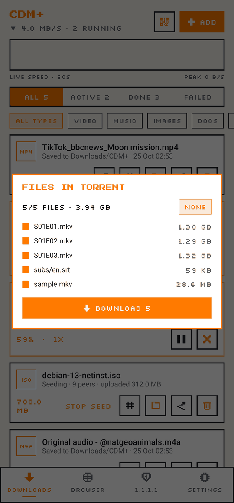<br><sub><b>Torrents</b></sub></td>
    <td align="center">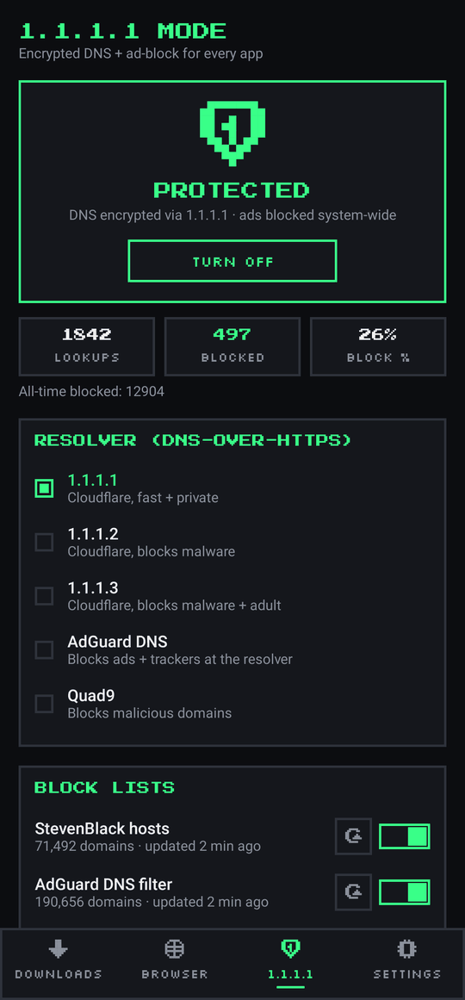<br><sub><b>1.1.1.1 ad-block</b></sub></td>
    <td align="center">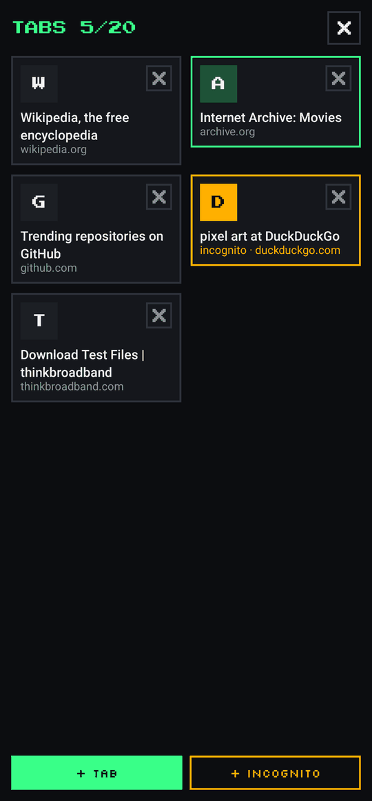<br><sub><b>Browser tabs</b></sub></td>
  </tr>
  <tr>
    <td align="center">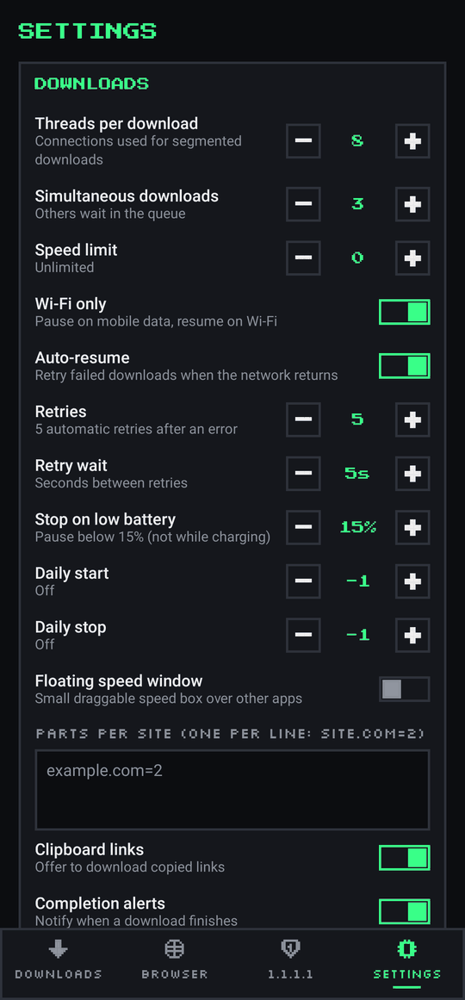<br><sub><b>Settings</b></sub></td>
    <td align="center">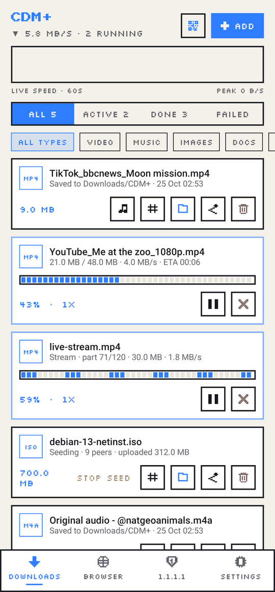<br><sub><b>Light theme</b></sub></td>
    <td align="center">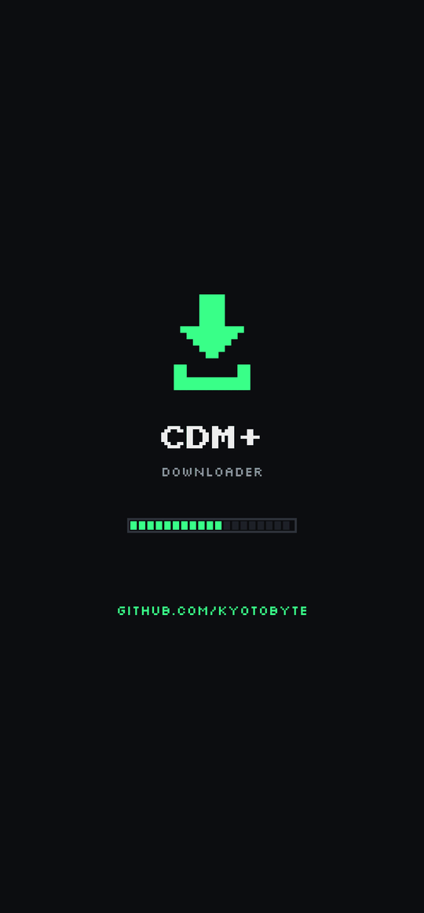<br><sub><b>Splash</b></sub></td>
  </tr>
</table>

</div>

## ✨ Features

### ⚡ Download engine
- 🚀 **Multi-connection downloads**: 1–32 connections per file (default 8) with dynamic splitting, so every connection stays busy to the end
- ⏯️ Pause / resume, even after the app is closed or the phone restarts; retry, queue, speed limits
- 🎞️ HLS / m3u8 streams joined into one `.mp4`
- 🧲 **Torrents & magnet links**: pick files, optional seeding with limits; FTP too
- ✅ Correct file names, checksums (MD5 / SHA-1 / SHA-256), zip extract, refresh an expired link

### 🎯 Grabbers
- ▶️ **YouTube**: videos, Shorts, playlists (plus SoundCloud, Bandcamp, PeerTube)
- 📷 **Instagram** public posts, reels and carousels · 🎵 **TikTok** public posts, with "Extract music"
- ☁️ **MEGA** file links **and folder links**: pick files or select all, folder structure kept, decrypted on your phone

### 🌐 Built-in browser
- 🖐️ **GRAB** button finds the downloadable media on any page
- 🛡️ Ad-block, tabs, reading mode, link crawler
- 🕶️ **Incognito** tabs with their own cookie jar, wiped on close
- 🔐 **Password vault** (Android Keystore + fingerprint)

### 📱 App
- 🏎️ Native **120 Hz+** high refresh rate where the screen supports it
- 🧱 **1.1.1.1 mode**: DNS-only VPN with DNS-over-HTTPS and ad/tracker block lists for the whole phone
- 🎨 Dark / AMOLED / light themes, custom accent, floating speed window, quick-settings tiles, QR scan
- 📂 Saves to `Downloads/CDM+` or any folder / SD card you choose
- 🔔 Update & announcement notifications (toggle in Settings)

## 🔧 Install

1. ⚠️ **Had an older test build of CDM+?** Uninstall it first. The package name changed, so the new version can't install over it.
2. Download the right APK from [Releases](https://github.com/KyotoByte/CDM-Plus-Downloader/releases/latest) (see [Which APK?](#-which-apk)).
3. Open it and allow "Install unknown apps" for your browser / file manager when Android asks.
4. Launch CDM+ and allow notifications, so downloads keep running in the background.

**Requirements:** Android 7.0 (API 24) or newer · built for Android 16 (API 36)

## 🛠️ Build from source

```bash
git clone https://github.com/KyotoByte/CDM-Plus-Downloader.git
cd CDM-Plus-Downloader

./gradlew assembleRelease         # per-ABI + universal release APKs
./gradlew assembleDebug           # debug APK
./gradlew testDebugUnitTest       # JVM unit tests
```

Needs JDK 17+ and the Android SDK (compileSdk 37). APKs land in `app/build/outputs/apk/`.

> [!NOTE]
> Release signing is **not included** in this repo. To sign your own builds, create `keystore/signing.properties`:
> ```properties
> storeFile=keystore/your-release.jks
> storePassword=...
> keyAlias=...
> keyPassword=...
> ```
> Without it, the release build comes out unsigned. `keystore/` is git-ignored.

## 🧰 Tech stack

| | |
|---|---|
| Language | Kotlin 2.4 (JVM 17) |
| UI | Jetpack Compose + Material 3, custom pixel components |
| Async | Kotlin Coroutines |
| Networking | OkHttp |
| YouTube & co. | NewPipeExtractor |
| Torrents | libtorrent4j (libtorrent) |
| HTML | jsoup |
| QR | ZXing |
| Build | Gradle 9 (Kotlin DSL), Android Gradle Plugin 9 |
| Min / target SDK | 24 / 36 |

<details>
<summary><b>Project layout</b></summary>

```
app/src/main/java/io/github/kyotobyte/cdmplus/
├── engine/    download engine: segmented / HLS / FTP / torrent downloaders, queue, persistence
├── grab/      YouTube / Instagram / TikTok / MEGA grabbers
├── service/   foreground service, MediaStore/SAF publishing, alarms, notifications
├── ui/        Compose screens and pixel components
├── data/      settings, browser data, ad-block, password vault
└── vpn/       1.1.1.1 mode (DNS packets, DoH resolver, block lists, VpnService)
```
</details>

## ❓ FAQ

<details>
<summary><b>How does YouTube downloading work?</b></summary>

Through [NewPipeExtractor](https://github.com/TeamNewPipe/NewPipeExtractor), the same open-source library the NewPipe app uses. No Google account and no API key needed. Pick a quality; high-res video and audio are merged into one file.
</details>

<details>
<summary><b>Why does a MEGA download stop with "transfer limit reached"?</b></summary>

CDM+ respects MEGA's own transfer quota. When MEGA says the free limit is reached, CDM+ stops and tells you, instead of trying to get around it. Try again later.
</details>

<details>
<summary><b>Can it download Netflix / Prime / Disney+ or other DRM videos?</b></summary>

No. DRM-protected content is not supported and never will be. CDM+ also doesn't bypass a site's login or download limits.
</details>

<details>
<summary><b>Instagram / TikTok says "private" or fails?</b></summary>

Only public posts can be grabbed. Private accounts and login-only content are not supported.
</details>

<details>
<summary><b>Torrents don't work on my device?</b></summary>

Torrents need the arm64-v8a, armeabi-v7a or x86_64 APK (or universal). The 32-bit x86 build has no torrent engine and the app tells you so.
</details>

<details>
<summary><b>"App not installed" error?</b></summary>

Uninstall any older CDM+ test build first, or try the universal APK.
</details>

## 🙏 Credits

All code in this repository was written from scratch for CDM+. Full list with licenses in [CREDITS.md](CREDITS.md).

- **Fonts** (SIL OFL 1.1): [Press Start 2P](https://github.com/google/fonts/tree/main/ofl/pressstart2p), [Silkscreen](https://github.com/google/fonts/tree/main/ofl/silkscreen)
- **Libraries**: AndroidX & Jetpack Compose, Kotlin & kotlinx (JetBrains), [OkHttp](https://github.com/square/okhttp) (Square), [NewPipeExtractor](https://github.com/TeamNewPipe/NewPipeExtractor) (Team NewPipe), [libtorrent4j](https://github.com/aldenml/libtorrent4j) / [libtorrent](https://github.com/arvidn/libtorrent), [jsoup](https://jsoup.org), [ZXing](https://github.com/zxing/zxing) + [zxing-android-embedded](https://github.com/journeyapps/zxing-android-embedded)
- **Ad-block lists** (downloaded on demand, not bundled): StevenBlack hosts, AdGuard DNS filter, OISD, EasyList
- **Art**: app icon and all pixel icons are original pixel art drawn for CDM+

## 📄 License

CDM+ Downloader is free software under the **[GNU General Public License v3.0](LICENSE)**.
It includes NewPipeExtractor (GPL-3.0), so the whole app is GPL-3.0: you can use, study, share and modify it, and derivatives must stay open source under the same license.

## 👤 Developer

<a href="https://github.com/KyotoByte"></a>

https://github.com/KyotoByte

<div align="center">
<br>
<sub>If CDM+ is useful to you, leave a ⭐ on the repo!</sub>
</div>
